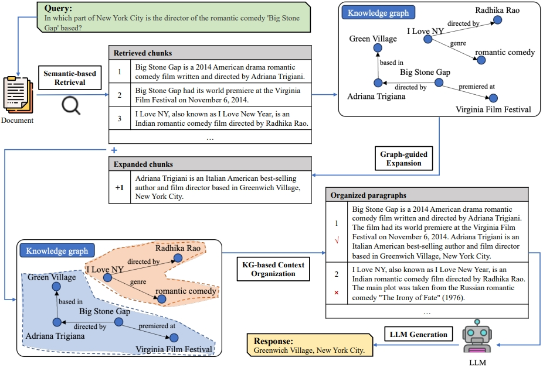

# Hybrid Seed Retrieval for KG2RAG in Biomedical QA

Final-year thesis code, built on
[KG²RAG](https://github.com/nju-websoft/KG2RAG) (Zhu et al., NAACL 2025).

KG²RAG answers questions in three steps. It first retrieves a few *seed chunks*
with dense embeddings, then uses a knowledge graph to pull in related chunks,
and finally filters and orders that context before the LLM writes the answer.
This project keeps the knowledge-graph steps as they are and changes only the
first one. Dense-only seed retrieval is replaced by a **static hybrid of BM25
and dense retrieval, fused with Reciprocal Rank Fusion (RRF)**. We evaluate it
on biomedical factoid QA from BioASQ.

> **Status:** work in progress. The `dense` and `bm25` runs in `output/` are
> preliminary experiments that motivate the problem. The proposed method
> (`--retriever rrf`, with MedCPT as the dense encoder) is not implemented yet.


*KG²RAG framework (figure from the original paper). This work modifies the
semantic (seed) retrieval stage.*

## Repository structure

```
.
├── code/
│   ├── kg_rag_distractor.py   # main pipeline (candidate pool → seed retrieval → KG2RAG → answer)
│   ├── retrievers.py          # seed retrievers: dense, bm25, hybrid_alpha, rrf
│   ├── evaluate.py            # SAcc, LAcc, MRR, ROUGE-2, Hit@k, retrieval MRR
│   ├── preprocess/            # question subsets and KG triplet extraction
│   └── util/                  # KG expansion / filtering / synthesis (from KG2RAG)
├── data/
│   ├── bioasq/                # BioASQ factoid questions, 200-question subset, extracted KGs
│   └── ragmini/               # rag-mini-bioasq subset and extracted KGs
├── output/                    # prediction files
├── scripts/run_ablation.sh    # dense vs. BM25 vs. RRF on BioASQ
└── requirements.txt
```

## Setup

```bash
pip install -r requirements.txt
```

**Models**

| Role | Default | Flag |
|---|---|---|
| Generator / KG extractor | `meta-llama/Llama-3.1-8B-Instruct` served by vLLM at `localhost:8000` | `--llm_model`, `--llm_api_base` |
| Dense embeddings | `mixedbread-ai/mxbai-embed-large-v1` (Hugging Face) | `--embed_model` |
| Reranker | `BAAI/bge-reranker-large`, downloaded to `model/bge-reranker-large` | `--reranker` |

```bash
# reranker
huggingface-cli download BAAI/bge-reranker-large --local-dir model/bge-reranker-large
# LLM server
vllm serve meta-llama/Llama-3.1-8B-Instruct --port 8000
```

**Data.** Put the BioASQ factoid questions in `data/bioasq/factoid.json`, then
follow [`code/preprocess/readme.md`](code/preprocess/readme.md) to build the
subsets and extract the KGs. The rag-mini-bioasq corpus, which supplies the
distractor passages, downloads automatically from Hugging Face.

## Usage

Run commands from `code/`.

```bash
# Original KG2RAG seed retrieval (dense only)
python kg_rag_distractor.py --dataset bioasq --retriever dense \
    --data_path ../data/bioasq/factoid_subset_200.json \
    --kg_dir ../data/bioasq/kgs/extract_subkgs \
    --result_path ../output/bioasq/bioasq200_dense.json

# Evaluate
python evaluate.py ../output/bioasq/bioasq200_dense.json ../data/bioasq/factoid_subset_200.json
```

`--retriever` options:

| Value | Seed retrieval |
|---|---|
| `dense` | dense similarity only (KG²RAG baseline) |
| `bm25` | BM25 only |
| `hybrid_alpha` | `alpha · dense + (1 − alpha) · BM25` on min-max normalised scores (`--alpha`) |
| `rrf` | Reciprocal Rank Fusion of the dense and BM25 rankings (`--rrf_k`, default 60), the proposed method |

To run the full ablation, use `bash scripts/run_ablation.sh`. Use
`--dataset ragmini` with the rag-mini paths to run on rag-mini-bioasq instead.

### Evaluation metrics

* **Answer quality:** Strict Accuracy, Lenient Accuracy and MRR over the top-5
  predicted entities, plus ROUGE-2 F1 of the justification against the BioASQ
  ideal answer. Add `--compliant_only` to score only answers that follow the
  numbered-list format.
* **Seed retrieval:** Hit Rate@k and MRR. A document counts as gold if one of
  its snippets contains an exact answer.

## Known issues

* For BioASQ string IDs the distractor pool is seeded with Python's `hash()`.
  That value changes between processes unless `PYTHONHASHSEED` is fixed, so
  `scripts/run_ablation.sh` sets `PYTHONHASHSEED=0`.
* `extract_kg_bioasq.py` builds pools with 15 distractors, while the pipeline
  defaults to 100 for `bioasq`. Distractors beyond the first 15 therefore have no
  extracted KG.

## Acknowledgements

This repository is a fork of the official KG²RAG implementation. The modules in
`code/util/` and the overall pipeline come from the original authors. Please
cite their paper:

```bibtex
@inproceedings{KG2RAG,
  title     = {Knowledge Graph-Guided Retrieval Augmented Generation},
  author    = {Zhu, Xiangrong and Xie, Yuexiang and Liu, Yi and Li, Yaliang and Hu, Wei},
  booktitle = {NAACL},
  year      = {2025}
}
```

Licensed under the same terms as the original repository (see [LICENSE](LICENSE)).
